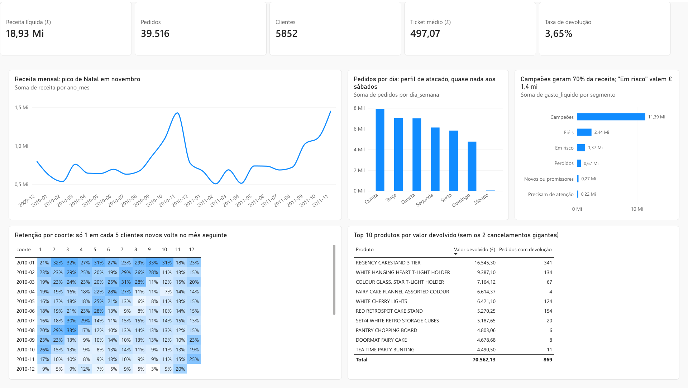

# Análise de Varejo com SQL: Curva ABC, Clientes e Retenção

Análise de **1 milhão de vendas reais** de uma loja online do Reino Unido (2009–2011), feita principalmente em **SQL**, com DuckDB.

> 🚧 **Projeto em andamento.** Veja o [roteiro](#-roteiro) no fim da página.

   

## 🎯 Perguntas de negócio

1. **Quais produtos sustentam a receita?** (curva ABC)
2. **Quem são os melhores clientes e quem está deixando de comprar?** (segmentação RFM)
3. **Quantos clientes voltam a comprar depois do primeiro pedido?** (análise de coorte e retenção)
4. **Quais produtos mais voltam em devolução, e quanto isso custa?**

## 📊 Dashboard



Página executiva feita no Power BI web a partir das tabelas que o SQL gera. Arquivos: [`powerbi/dashboard_varejo.pbix`](powerbi/dashboard_varejo.pbix) (abre no Power BI Desktop) e [`powerbi/dashboard_varejo.pdf`](powerbi/dashboard_varejo.pdf). Passo a passo em [`powerbi/GUIA.md`](powerbi/GUIA.md).

## 📌 Primeiros resultados

- **24% dos clientes (os "Campeões") geram 70% da receita líquida.** Na mediana, compraram há 17 dias e já fizeram 11 pedidos.
- **711 clientes "Em risco" valem £ 1,4 milhão:** compravam com frequência, mas não voltam há cerca de um ano. É a lista prioritária para uma ação de reativação.
- **Só 1 em cada 5 clientes novos volta no mês seguinte** (21%), e 29% nunca voltam a comprar. Quem passa dessa fase, porém, continua: a retenção fica perto de 18% mesmo depois de um ano.
- **Clientes de Natal voltam no Natal seguinte:** quem estreia entre setembro e novembro quase não compra nos meses seguintes (10–14%), mas 19–25% voltam 12 meses depois.
- **22% dos produtos geram 80% da receita líquida** (1.038 de 4.689 itens). Na outra ponta, metade do catálogo (classe C) soma só 5% da receita e tem o dobro da taxa de devolução (4,4% contra 2,3%).
- **Os cordões de luz "Cherry Lights" voltam demais:** as três cores foram devolvidas 59 a 124 vezes, com taxas de 30% a 36%. É um forte indício de defeito para investigar com o fornecedor.
- **A loja quase não vende aos sábados** e concentra os pedidos de terça a quinta. É um comportamento típico de **atacado**: muitos clientes são lojistas que revendem os produtos.
- **Sazonalidade forte de Natal:** em novembro a receita chega a **2,2 vezes** a média mensal do primeiro semestre.
- **2011 ficou estável:** a receita de janeiro a novembro cresceu só 3% contra 2010, com **4% menos pedidos**, compensados por um ticket médio **7% maior**.

| Indicador | Valor |
| --- | --- |
| Receita bruta (mercadorias, dez/2009 a dez/2011) | £ 19,6 milhões |
| Devoluções | £ 716 mil (3,6% das vendas) |
| Pedidos | 39.516 |
| Clientes identificados | 5.852 em 41 países |
| Ticket médio por pedido | £ 497 |

## 👥 Segmentação RFM

Cada cliente recebe uma nota de 1 a 5 em **Recência** (dias desde a última compra), **Frequência** (número de pedidos) e **Monetário** (gasto líquido, já descontadas as devoluções). Detalhes em [`sql/04_rfm.sql`](sql/04_rfm.sql).

| Segmento | Clientes | % da receita | Recência mediana | Pedidos (mediana) |
| --- | ---: | ---: | ---: | ---: |
| Campeões | 1.390 (24%) | 69,6% | 17 dias | 11 |
| Fiéis | 1.188 (20%) | 14,9% | 72 dias | 4 |
| Em risco | 711 (12%) | 8,4% | 367 dias | 4 |
| Perdidos | 1.631 (28%) | 4,1% | 431 dias | 1 |
| Novos ou promissores | 509 (9%) | 1,6% | 26 dias | 2 |
| Precisam de atenção | 423 (7%) | 1,4% | 95 dias | 1 |

**Duas decisões de método:**

- **Gasto líquido, não bruto.** Alguns clientes compraram e cancelaram tudo no mesmo dia: o cliente 16446 comprou £ 168 mil e devolveu £ 168 mil. Sem descontar as devoluções, ele apareceria como um dos maiores clientes.
- **Frequência em faixas fixas** (1, 2, 3–4, 5–9 e 10+ pedidos), e não em quintis: 28% dos clientes compraram uma única vez, e a divisão automática colocaria clientes empatados em notas diferentes por acaso.

## 🔁 Retenção por coorte

Uma **coorte** é o grupo de clientes que fez a primeira compra no mesmo mês. A tabela mostra que % de cada coorte de 2010 voltou a comprar 1, 2, 3... meses depois ([`sql/05_coorte.sql`](sql/05_coorte.sql)).

| Coorte | Clientes | Mês 1 | Mês 2 | Mês 3 | Mês 6 | Mês 9 | Mês 12 |
| --- | ---: | ---: | ---: | ---: | ---: | ---: | ---: |
| 2010-01 | 368 | 21,5% | 32,1% | 31,5% | 26,9% | 32,6% | 22,8% |
| 2010-03 | 441 | 19,0% | 23,1% | 24,3% | 24,7% | 10,9% | 20,0% |
| 2010-06 | 267 | 17,6% | 18,7% | 20,6% | 12,7% | 11,2% | 15,0% |
| 2010-09 | 239 | 23,0% | 23,4% | 13,0% | 13,8% | 13,0% | 22,6% |
| 2010-11 | 326 | 17,5% | 9,5% | 9,5% | 12,9% | 9,2% | **25,2%** |

A matriz completa, com todas as coortes, fica em [`resultados/`](resultados/).

**Cuidados de método:**

- **Dezembro de 2009 fica fora das comparações.** A base começa nesse mês, então ali aparecem 951 "clientes novos", quase 3 vezes a média, porque clientes antigos parecem estrear junto com a base.
- **Dezembro de 2011 fica fora** porque tem só 9 dias de dados.
- **Na curva média, coortes sem compra em algum mês contam como 0%**, e cada coorte só entra nos meses que já teve tempo de alcançar.

## ↩️ Devoluções

As devoluções somam **£ 716 mil (3,6% das vendas)**, mas esse número esconde duas armadilhas ([`sql/06_devolucoes.sql`](sql/06_devolucoes.sql)):

- **Dois cancelamentos gigantes respondem por 34% de todo o valor devolvido.** Foram pedidos de 80.995 e 74.215 unidades de um único produto, cancelados inteiros logo depois. Parecem erro de lançamento, não devolução de cliente. Sem eles, a taxa de devolução cai para **2,4%**.
- **Cerca de 1/3 do valor restante parece correção de pedido:** o mesmo cliente comprou a mesma quantidade do mesmo produto até 1 dia antes ou depois da "devolução". Por isso, o ranking de produtos só considera itens devolvidos em pelo menos 5 pedidos diferentes, que é sinal de problema recorrente.

| Produto | Vendidos | Devolvidos | Taxa | Vezes devolvido |
| --- | ---: | ---: | ---: | ---: |
| WHITE CHERRY LIGHTS | 3.004 | 1.088 | 36,2% | 124 |
| LIGHT PINK CHERRY LIGHTS | 1.433 | 458 | 32,0% | 59 |
| PINK CHERRY LIGHTS | 2.281 | 693 | 30,4% | 86 |
| TEA TIME PARTY BUNTING | 6.013 | 1.635 | 27,2% | 11 |

**Correção feita durante a análise:** a primeira versão da curva ABC usava a receita bruta e colocava no top 10 dois produtos que foram vendidos e devolvidos inteiros (um deles com £ 168 mil vendidos e £ 168 mil devolvidos). A curva agora usa a receita líquida.

## 🧹 Qualidade dos dados

A base bruta tem 1.067.371 linhas. Antes de analisar, o arquivo [`sql/00_qualidade.sql`](sql/00_qualidade.sql) encontrou:

- **34.335 linhas duplicadas**;
- **19.494 linhas de cancelamento** (faturas que começam com "C");
- **22,8% das linhas sem cliente identificado**;
- **6.202 vendas com preço zero**;
- códigos que **não são mercadoria** misturados com as vendas: frete (`POST`, `DOT`), taxas da Amazon e bancárias, descontos, amostras e ajustes manuais.

A limpeza em [`sql/01_limpeza.sql`](sql/01_limpeza.sql) mantém **94% das linhas** e organiza os dados em três tabelas: `vendas`, `devolucoes` e `produtos`. Vendas sem cliente continuam no faturamento, mas ficam de fora das análises de clientes.

## 🗂️ Estrutura

```text
├── carregar_dados.py      <- Baixa a planilha da UCI e carrega no DuckDB (tabela vendas_brutas)
├── rodar_sql.py           <- Executa um arquivo .sql e mostra/salva os resultados
├── exportar_powerbi.py    <- Exporta o modelo estrela em Parquet (Desktop) ou CSVs agregados com --web
├── powerbi/
│   ├── dashboard_varejo.pbix  <- Relatório do Power BI com os dados (abre no Power BI Desktop)
│   ├── dashboard_varejo.pdf   <- Página executiva exportada
│   └── GUIA.md                <- Passo a passo do dashboard: versão web e Desktop
├── img/                   <- Print do dashboard usado neste README
├── sql/
│   ├── 00_qualidade.sql   <- Diagnóstico: nulos, duplicadas, cancelamentos, códigos estranhos
│   ├── 01_limpeza.sql     <- Cria as tabelas vendas, devolucoes e produtos
│   ├── 02_visao_geral.sql <- Indicadores, evolução mensal, dia da semana e países
│   ├── 03_curva_abc.sql   <- Curva ABC com funções de janela (receita líquida)
│   ├── 04_rfm.sql         <- Segmentação RFM de clientes (recência, frequência e valor)
│   ├── 05_coorte.sql      <- Coortes mensais e curva de retenção
│   └── 06_devolucoes.sql  <- Taxa de devolução por produto, classe ABC e mês
├── resultados/            <- CSV gerados pelas consultas
└── requirements.txt
```

**Técnicas de SQL usadas:** CTEs (`WITH`), funções de janela (`SUM() OVER`, `ROW_NUMBER`, `LAG`, `NTILE`, `FIRST_VALUE` com `PARTITION BY`), tabela cruzada com agregação condicional (`MAX(CASE WHEN ...)`), `CASE WHEN`, agregações com `FILTER`, `DISTINCT` para remover duplicadas, `EXISTS` com subconsulta correlacionada, `VIEW` e expressões regulares.

## 🔁 Como reproduzir

```bash
pip install -r requirements.txt
```

```bash
python carregar_dados.py
```

```bash
python rodar_sql.py sql/01_limpeza.sql
```

Depois rode qualquer análise, por exemplo:

```bash
python rodar_sql.py sql/03_curva_abc.sql --csv
```

O DuckDB não precisa de servidor: o banco é o arquivo `data/varejo.duckdb`. O SQL segue o padrão do PostgreSQL.

## 🧭 Roteiro

- [x] Carga dos dados no DuckDB
- [x] Diagnóstico de qualidade
- [x] Limpeza e modelagem (vendas, devoluções, produtos)
- [x] Visão geral do negócio
- [x] Curva ABC de produtos
- [x] Segmentação RFM de clientes
- [x] Coorte e retenção mensal
- [x] Devoluções por produto
- [x] Exportação em modelo estrela para o Power BI
- [x] Dashboard executivo no Power BI web (passo a passo em [`powerbi/GUIA.md`](powerbi/GUIA.md))
- [ ] Conclusões e recomendações para o negócio

## 📄 Dados

[Online Retail II](https://archive.ics.uci.edu/dataset/502/online+retail+ii), UCI Machine Learning Repository (Daqing Chen), licença [CC BY 4.0](https://creativecommons.org/licenses/by/4.0/). Os dados não ficam no repositório: o `carregar_dados.py` baixa a planilha.

---

**Ieda Oliveira** · [Portfólio](https://iedahirari.github.io/portifolio/) · [LinkedIn](https://www.linkedin.com/in/ieda-oliveira/)
